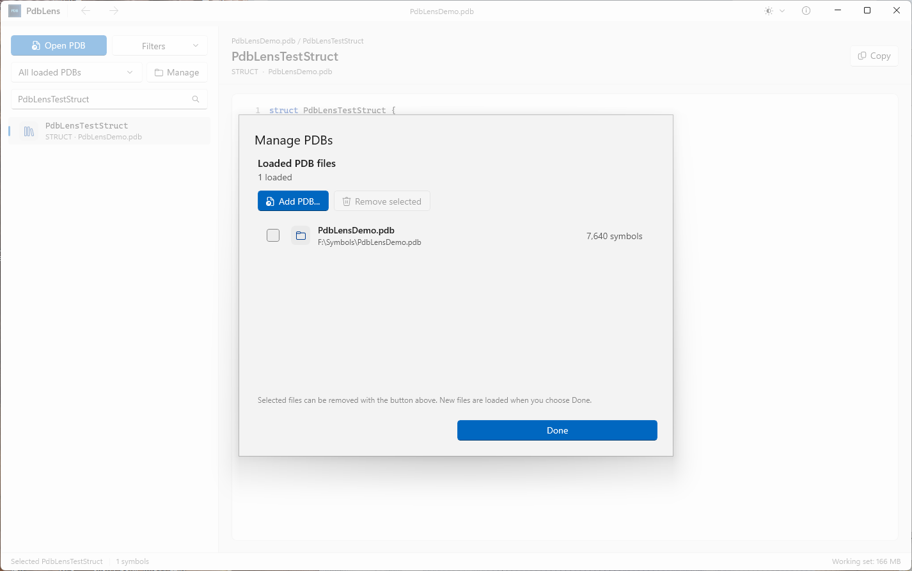
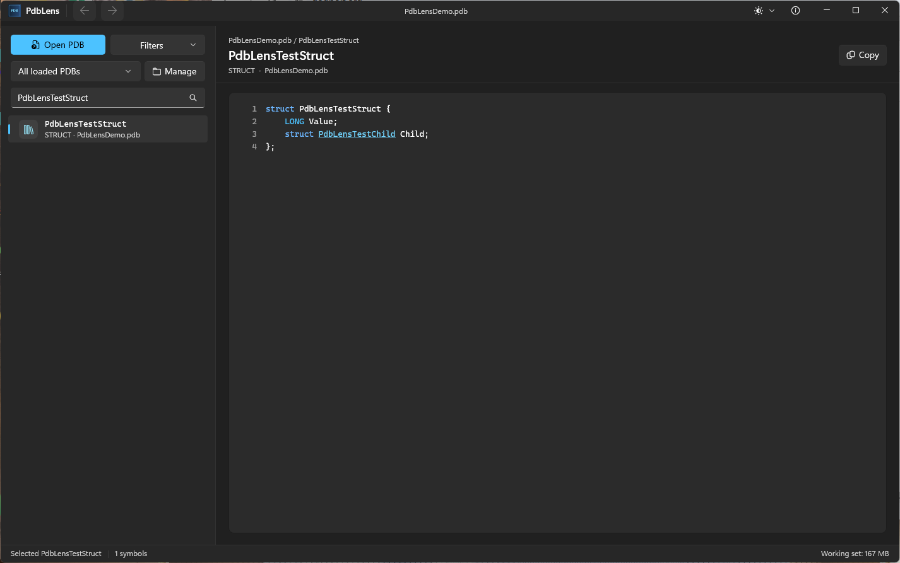
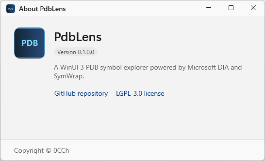

<p align="center">
  
</p>

<h1 align="center">PdbLens</h1>

<p align="center">
  A fast, native WinUI 3 explorer for PDB symbols, C/C++ type definitions, and linked child structures.
</p>

<p align="center">
  <a href="https://github.com/0cch/PdbLens/stargazers">
    
  </a>
  
  
  
  <a href="LICENSE">
    
  </a>
</p>


PdbLens is built for reverse engineers, Windows developers, and debugging-tool
authors who need to inspect PDB symbols without a heavyweight IDE. It uses
Microsoft DIA through [SymWrap](https://github.com/0cch/SymWrap) and renders
definitions with native WinUI 3 controls. WebView2 is not required.

> If PdbLens saves you time, please consider giving the repository a star. It
> helps more PDB and reverse-engineering users discover the project.

## Why PdbLens?

- **Native and fast** - WinUI 3 with a native `RichTextBlock` code surface.
- **Built for large PDBs** - symbols are indexed natively and loaded page by page.
- **Follow the types** - click a child structure in a definition to jump directly to it.
- **No IDE required** - inspect structs, enums, typedefs, functions, data, and public symbols.
- **Local by design** - PDB content is processed locally and is never uploaded.
- **Readable in any theme** - system, light, and dark themes share the same Fluent layout.

## Highlights

### Explore C/C++ definitions

The right-hand code view renders the first-level definition generated from DIA
type information, with syntax highlighting, line numbers, text selection, and a
one-click copy action.

### Navigate linked type definitions

Member types that are present in the loaded symbol index become clickable links.
Selecting a linked type:

1. loads its definition on the right,
2. selects and scrolls to it in the symbol list,
3. adds the previous symbol to Back/Forward navigation history.

### Manage multiple PDB files

Add one or more PDB files, inspect their paths and symbol counts, and remove
multiple files from a single management dialog.



### Fluent light and dark themes

Use the Windows setting or explicitly choose Light or Dark. The code palette,
window controls, and Fluent surfaces update together.



### Built-in About and version information

The About window shows the current package version, source repository, license,
and copyright.



## Supported symbols

| Category | Supported |
|---|:---:|
| Structs | Yes |
| Classes | Yes |
| Unions | Yes |
| Enums | Yes |
| Typedefs | Yes |
| Functions, including private symbols | Yes |
| Global data | Yes |
| Public symbols | Yes |

## Quick start

1. Open the [Releases](https://github.com/0cch/PdbLens/releases) page.
2. Choose one of the published packages:
   - **Offline MSIX** for a fully self-contained installation.
   - **Online MSIX** for a smaller download when .NET 10 is already installed.
   - **Portable ZIP** to extract and run without installation.
3. Open a `.pdb` file with the toolbar, drag-and-drop it, or pass it on the command line.
4. Search, filter, and select a symbol from the left pane.

```powershell
PdbLens.exe C:\symbols\example.pdb
```

Multiple PDB files can be passed at once:

```powershell
PdbLens.exe C:\symbols\one.pdb C:\symbols\two.pdb
```

## Package formats

| Artifact | .NET included | Windows App SDK included | Recommended use |
|---|:---:|:---:|---|
| `*-x64-offline.msix` | Yes | Yes | Clean or offline machines |
| `*-x64-online.msix` | No | Yes | Smaller download; requires .NET 10 Desktop Runtime |
| `*-win-x64.zip` | Yes | Yes | Portable, no installation |
| `*-symbols.zip` | N/A | N/A | App, Core, launcher, and native PDB symbols |

The lightweight online MSIX starts through a native launcher. If the .NET 10
Desktop Runtime is missing, it offers to open Microsoft's official download page.
No standalone online installer is required.

## Build from source

### Requirements

- Windows 10 1809 or newer, x64.
- Visual Studio 2022 with:
  - Desktop development with C++
  - Windows SDK
  - DIA SDK
- .NET 10 SDK.
- Git submodules initialized:

```powershell
git submodule update --init --recursive
```

### Debug build

```powershell
.\build.ps1 -Configuration Debug
```

### Build release packages

Complete offline MSIX:

```powershell
.\build.ps1 -Configuration Release -Package -PackageKind Full
```

Lightweight online MSIX:

```powershell
.\build.ps1 -Configuration Release -Package -PackageKind Lean
```

Generate all local artifacts, including portable and symbols ZIP files:

```powershell
.\scripts\Build-LocalArtifacts.ps1
```

The application is produced under:

```text
src/PdbLens.App/bin/x64/Debug/net10.0-windows10.0.26100.0/win-x64/
```

## Design notes

### Memory behavior

- Native indexes store symbol IDs and category metadata, not symbol names.
- Symbol names are queried page by page.
- The UI retains at most 1,600 visible symbol rows.
- Only the selected definition is retained in the UI.
- Unloading a PDB releases its DIA session and symbol index.

### Threading model

All DIA calls run on one dedicated STA worker thread. The UI never accesses DIA
objects directly.

```text
PdbLens.App       WinUI 3 UI, native renderer, navigation
PdbLens.Launcher  .NET runtime detection and managed app launcher
PdbLens.Core      P/Invoke contract, worker thread, paging models
PdbLens.Native    C ABI bridge, compact symbol index, DIA definitions
SymWrap           DIA lifecycle and rendering primitives
```

### Native type navigation

The native layer resolves direct member types through DIA relationships and
returns UTF-16 link ranges. WinUI renders those ranges as hyperlinks instead of
parsing rendered C/C++ with regular expressions.

## Release workflow

Release tags use the four-part form `vX.Y.Z.BUILD`. Pushing a base tag such as
`v1.2.3` starts the tag-only release workflow, which increments `BUILD`, builds
and validates all artifacts, creates the final tag, and opens a **draft** GitHub
Release for manual acceptance.

Ordinary branch pushes do not trigger GitHub Actions.

### Code signing

Production releases should configure:

- `WINDOWS_CERTIFICATE_BASE64`
- `WINDOWS_CERTIFICATE_PASSWORD`
- `WINDOWS_PUBLISHER` when the certificate subject differs from `CN=PdbLens`

Unsigned packages are intended only for inspection and manual testing. Do not
install untrusted certificates on user machines.

## Troubleshooting

Managed startup and unhandled exceptions are written to:

```text
%LOCALAPPDATA%\PdbLens\crash.log
```

Native Windows component failures are also available in Event Viewer.

## Third-party components

- Microsoft Windows App SDK
- Microsoft .NET
- Microsoft DIA SDK / `msdia140.dll`
- SymWrap, LGPL-3.0

See [THIRD-PARTY-NOTICES.md](THIRD-PARTY-NOTICES.md).

## Contributing

Issues and pull requests are welcome. If PdbLens saves you time, consider
starring the repository so more PDB and reverse-engineering users can find it.

## License

Copyright © 0CCh.

PdbLens is licensed under LGPL-3.0. See [LICENSE](LICENSE).
